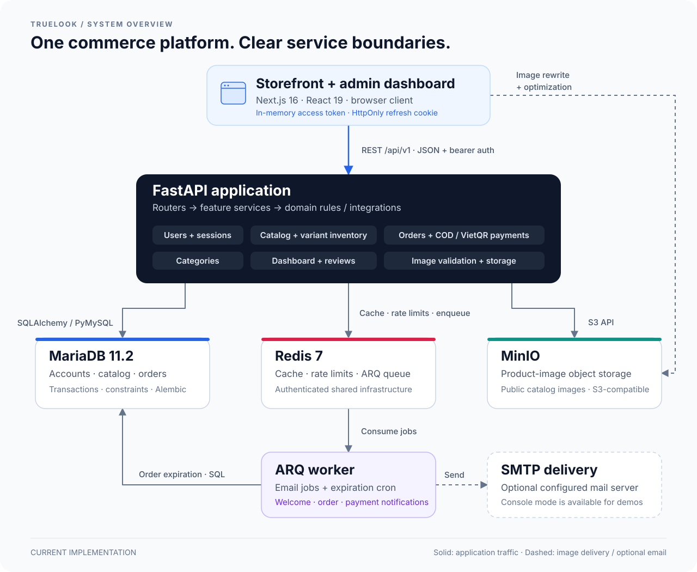

# TrueLook (AI-VTON) — E-Commerce Platform & Admin Dashboard

A full-stack clothing shop with a customer storefront, an admin dashboard, a versioned FastAPI API, variant-based inventory, COD and VietQR checkout, MinIO product images, and ARQ background jobs.

The current release focuses on a working commerce foundation. **Virtual try-on is not implemented yet.** VietQR supports QR generation and an application-specific payment webhook; automatic bank/provider integration is a separate step.

## 📑 Table of Contents

- [Architecture Overview](#architecture-overview)
- [Tech Stack](#tech-stack)
- [Key Features](#key-features)
- [Directory Structure](#directory-structure)
- [Prerequisites](#prerequisites)
- [Getting Started & Installation](#getting-started--installation)
- [Configuration](#configuration)
- [Default Seed Accounts](#default-seed-accounts)
- [API Documentation](#api-documentation)
- [Frontend & Session Behavior](#frontend--session-behavior)
- [Testing](#testing)
- [Operations & Backups](#operations--backups)
- [Current Limits & New Modules](#current-limits--new-modules)
- [License](#license)

<a id="architecture-overview"></a>
## 🏛 Architecture Overview



HTTP routers validate requests, enforce authorization, and delegate to feature services. Services own SQLAlchemy queries and explicit transactions. Order policy lives in a database-independent domain module. Storage, queue, email, and VietQR are integration boundaries; worker jobs call the relevant services.

The backend uses synchronous SQLAlchemy/PyMySQL and MinIO clients. It is not a fully asynchronous I/O stack. Email enqueue after a committed write is best effort; an enqueue failure does not roll back the order. SQL and object storage are not one atomic transaction: failed image metadata writes trigger best-effort object cleanup.

<a id="tech-stack"></a>
## 💻 Tech Stack

| Layer | Technologies |
|---|---|
| Backend | Python, FastAPI, Pydantic, SQLAlchemy, Alembic |
| Database | MariaDB 11.2; SQLite for unit tests |
| Frontend | Next.js 16 App Router, React 19, TypeScript, Tailwind CSS, Radix UI |
| Client data | Axios and SWR |
| Authentication | JWT access tokens, HttpOnly refresh cookies, persistent device sessions |
| Jobs and cache | Redis 7 and ARQ; scheduled order expiration and email jobs |
| Images | MinIO object storage, Pillow validation, Next.js image optimization |
| Email | aiosmtplib and Jinja2; SMTP or console mode |
| Verification | Pytest, Hypothesis, Ruff, Vitest, Testing Library, Playwright, GitHub Actions |

Dependencies are pinned in backend hash-locked requirements and the frontend pnpm lockfile. Docker builds use Python 3.12 and Node.js 22; pnpm is pinned to 10.33.4. The native Windows Python lockfiles target Python 3.13.

<a id="key-features"></a>
## ✨ Key Features

### Customer storefront

- Browse, search, filter, and paginate clothing by category, gender, brand, size, color, price, and availability.
- View product galleries, descriptions, size charts, variant prices, and customer reviews.
- Choose a color/size before adding a variant to the browser-backed cart. **Quick Buy opens the product detail page for variant selection.**
- Check out multiple items as one order using COD or VietQR; server-side pricing and stock checks remain authoritative.
- View order history, order details, and public tracking with masked personal information.
- Cancel eligible orders: pending VietQR or confirmed COD before shipment, subject to server policy.
- Register, sign in with an email or username, edit a profile, change a password, and sign out.

### Admin dashboard

- Manage products, drafts, active variants, categories, customer accounts, and orders.
- Manage a product gallery and primary cover image, including upload, replacement, and deletion.
- Maintain size/color/SKU variants, optional price overrides, and inventory adjustments with audit reasons.
- View dashboard metrics, recent orders, and low-stock summaries.
- Update fulfillment/payment states and review exceptional payments for reconciliation.

### Commerce integrity

- Inventory belongs to variants; checkout uses `variant_id` and preserves order-item snapshots.
- Database constraints and row locking protect inventory and order transitions.
- VietQR webhook handling checks its secret and payment details, avoids duplicate transaction recording, and records exceptional payments for review.
- API image upload accepts static PNG/JPEG/WebP up to **5 MiB**, **8192 pixels per side**, and **16,000,000 total pixels**. Extension, MIME type, header, file structure, and decoded pixels are checked before storage. Corrupt, truncated, animated, or oversized images are rejected.

<a id="directory-structure"></a>
## 📂 Directory Structure

```text
backend/
  alembic/versions/        schema migrations
  app/
    core/                 settings, database, auth, errors, rate limiting, cache
    features/             users, categories, products, orders, dashboard, health
    integrations/         MinIO, Redis queue, SMTP, VietQR
    jobs/                 email and order-expiration tasks
    templates/emails/     HTML notification templates
    seed_assets/          bundled demo catalog illustrations
    main.py               app factory, middleware, routes, startup
    seed.py               demo accounts, clothing catalog, and sample orders
    worker.py             ARQ tasks and cron configuration
  tests/                  unit/regression and MariaDB integration tests
frontend/
  app/                    storefront, auth, and admin routes
  components/             shared UI components
  hooks/                  data access and selection state
  lib/                    API, sessions, types, and utilities
  tests/                  Vitest component and client tests
  e2e/                    Playwright acceptance scenarios
.github/
  workflows/              CI checks
  scripts/                disposable Compose tests, demo checks, and backup tools
docs/                     migration, payment, backup, and verification guidance
```

<a id="prerequisites"></a>
## 📋 Prerequisites

- Docker Desktop with Linux containers and Docker Compose v2 for the full local stack.
- Internet access for the first image/dependency build.
- Python to run the smoke/backup scripts; use the backend virtual environment for integration tests.
- Node.js 22 and pnpm 10.33.4 when running frontend development or browser tests outside Docker.
- For native backend development: Python 3.13 on Windows or Python 3.12 on Linux to match the supplied lockfiles.

Use an isolated demo database. Do not seed or run integration tests against production or shared data.

<a id="getting-started--installation"></a>
## 🚀 Getting Started & Installation

### 1. Run the complete Docker stack

From the repository root in PowerShell:

```powershell
# Only copy the example if .env does not already exist.
Copy-Item .env.example .env
# Review/edit .env before starting the stack.
docker compose up --build -d --wait
docker compose exec api python -m app.seed
```

The root `.env.example` is the canonical Compose/backend example. Keep existing local configuration when updating the source. Replace example credentials before using the stack outside disposable local development.

| Service | Default address |
|---|---|
| Storefront | http://localhost:3000/store |
| Admin sign-in | http://localhost:3000/login |
| Admin dashboard | http://localhost:3000/dashboard |
| API Swagger UI | http://localhost:8000/docs |
| API health | http://localhost:8000/api/v1/health |
| MinIO console | http://localhost:9001 |
| MinIO API | localhost:9000 |
| MariaDB | localhost:3307 |
| Redis | localhost:6379 |

Compose runs migrations before starting the API and worker. Confirm the schema version:

```powershell
docker compose exec api alembic current
```

The current head is `f8a1b2c3d4e5`. See the [migration guide](docs/MIGRATION_NOTES.md) for revision history and destructive rollback limits.

For multiple stacks, consistently use a separate project name, such as `docker compose -p truelook-demo ...`, and distinct host ports. The existing developer demo may use storefront/API ports 13000/18000 and MinIO ports 19000/19001; these are not the defaults above.

### 2. Develop the frontend locally

Keep the backend and infrastructure in Docker:

```powershell
docker compose up --build -d --wait mariadb redis minio migrate api arq_worker
cd frontend
Copy-Item .env.example .env.local
pnpm install --frozen-lockfile
pnpm dev
```

If Docker's frontend is already using port 3000, stop that service or use `pnpm dev --port 3001` and add the new origin to backend `CORS_ORIGINS`.

### 3. Run the backend outside Docker

From `backend/` on Windows:

```powershell
python -m venv .venv
.venv/Scripts/python.exe -m pip install --require-hashes -r requirements-dev-windows-lock.txt
.venv/Scripts/python.exe -m pip check
Copy-Item ../.env.example .env
```

On Linux/Python 3.12, install `requirements-dev-lock.txt` using `.venv/bin/python` instead.

Edit `backend/.env`: set `DATABASE_URL` and `REDIS_URL` to the host-exposed MariaDB/Redis ports, and `MINIO_ENDPOINT` to the host-exposed MinIO endpoint. Container names such as `mariadb:3306` only resolve inside the Compose network. Credentials must match the root configuration; URL-encode special characters in connection-string credentials. Match the API port and CORS origin to your frontend.

```powershell
.venv/Scripts/python.exe -m alembic upgrade head
.venv/Scripts/python.exe -m uvicorn app.main:app --reload --port 8000
```

### 4. Start the ARQ background worker

In a second configured `backend/` terminal:

```powershell
.venv/Scripts/python.exe -m arq app.worker.WorkerSettings
```

A real Redis connection is required for queued notifications and scheduled order expiration. `REDIS_URL=memory://` is a test/fallback mode, not a durable in-memory queue. The Compose worker is available when native worker behavior is unsuitable for your platform.

<a id="configuration"></a>
## ⚙️ Configuration

Environment variables override `.env`. The frontend has its own `.env.local` for native development. Do not commit real secrets or local `.env` files.

| Settings | Purpose |
|---|---|
| `MARIADB_ROOT_PASSWORD`, `MARIADB_DATABASE`, `MARIADB_USER`, `MARIADB_PASSWORD` | Database setup; application connections use the app user |
| `REDIS_PASSWORD` | Redis authentication |
| `SECRET_KEY` | JWT signing key; minimum 32 characters |
| `MINIO_ROOT_USER`, `MINIO_ROOT_PASSWORD`, `MINIO_ACCESS_KEY`, `MINIO_SECRET_KEY`, `MINIO_BUCKET` | Object-storage credentials and bucket |
| `MINIO_EXTERNAL_URL`, `NEXT_PUBLIC_IMAGE_HOST` | Browser-accessible image origin |
| `NEXT_PUBLIC_API_BASE_URL` | API origin or base ending in `/api/v1` |
| `CORS_ORIGINS` | Comma-separated allowed frontend origins |
| `REFRESH_COOKIE_SECURE`, `REFRESH_COOKIE_SAMESITE` | Refresh-cookie policy; use secure=false only for local plain HTTP |
| `FORWARDED_ALLOW_IPS` | Trusted reverse-proxy addresses |
| `VIETQR_BANK_ID`, `VIETQR_BANK_NAME`, `VIETQR_ACCOUNT_NO`, `VIETQR_ACCOUNT_NAME` | QR receiving-bank configuration |
| `VIETQR_WEBHOOK_SECRET` | Expected `X-Webhook-Secret`; an empty secret does not authorize callbacks |
| `ORDER_EXPIRE_MINUTES` | Pending VietQR lifetime; default 30 minutes, shared by API and worker |
| `APP_ENV`, `SEED_ADMIN_PASSWORD`, `SEED_CUSTOMER_PASSWORD` | Environment and demo-account settings |
| `EMAILS_ENABLED`, `EMAILS_CONSOLE_LOG` | Email disabled, console-only, or SMTP mode |
| `SMTP_HOST`, `SMTP_PORT`, `SMTP_USER`, `SMTP_PASSWORD`, `EMAILS_FROM_EMAIL`, `EMAILS_FROM_NAME` | SMTP sender configuration |
| `MARIADB_PORT`, `REDIS_PORT`, `MINIO_PORT`, `MINIO_CONSOLE_PORT`, `API_PORT`, `FRONTEND_PORT` | Host-port overrides |

Compose derives `DATABASE_URL` and `REDIS_URL` from its credentials unless explicitly overridden. After changing host ports, update the corresponding public URLs and `CORS_ORIGINS`. **Rebuild the frontend when changing `NEXT_PUBLIC_*` values** because they are embedded at build time.

Compose configures the frontend's internal MinIO rewrite through `MINIO_INTERNAL_URL`; browsers use `/storage/<bucket>/...`. Vercel Analytics renders only when `NODE_ENV=production` and `VERCEL=1`; the self-hosted Docker build does not load its script by default.

To send real email, set `EMAILS_ENABLED=true`, `EMAILS_CONSOLE_LOG=false`, and valid SMTP credentials. Console mode logs a rendered notification; it does not deliver it.

<a id="default-seed-accounts"></a>
## 👤 Default Seed Accounts

| Role | Email | Password with the example configuration |
|---|---|---|
| Admin | admin@example.com | `DemoAdmin!482` |
| Customer | user@example.com | `DemoCustomer!482` |

Seed creates 12 clothing products across tops, trousers, skirts/dresses, and outerwear, with size/color variants and three sample orders. It uploads bundled SVG illustrations to MinIO. These are demo images, not product photography or evidence of VTON quality; SVG is not accepted by the admin upload API.

Passwords come from `SEED_ADMIN_PASSWORD` and `SEED_CUSTOMER_PASSWORD`. If omitted, seed generates and prints passwords when creating accounts. Existing account passwords are preserved. Seed is for development/demo environments, not production.

To create a separate admin account interactively:

```powershell
docker compose exec api python -m app.cli create-admin --email admin@your-domain.test --username shopadmin
```

The CLI prompts for a password; public registration cannot assign an admin role.

<a id="api-documentation"></a>
## 📚 API Documentation

Swagger UI is available at `/docs`, ReDoc at `/redoc`, and the OpenAPI document at `/openapi.json`. Application endpoints use `/api/v1`.

| Group | Main operations |
|---|---|
| `/users` | Register, login, refresh, logout, current profile/password; admin customer management |
| `/categories` | Public reads and admin CRUD; hierarchy limited to two levels |
| `/products` | Public catalog/detail, filters, reviews, admin CRUD and image management |
| `/variants` | Admin variant management and audited stock adjustment |
| `/orders` | Cart checkout, owner/admin reads, cancellation, status changes, payment webhook, reconciliation and public tracking |
| `/dashboard` | Admin metrics, recent orders and low-stock summaries |
| `/health` | Database/Redis status |

Paged collections use `{ "items": [], "total": 0, "limit": 20, "offset": 0 }`; individual endpoints define their own default limits. Application errors use `{ "code": "...", "message": "...", "details": null }`. FastAPI request-validation errors retain their 422 format. See OpenAPI for exact payloads and access requirements.

### Checkout and payment behavior

- `POST /api/v1/orders/checkout-cart` requires authenticated checkout and `variant_id` for every line. Prices, totals, and stock are recalculated by the server. A cart must use one currency; VietQR accepts VND only.
- COD is the storefront default and starts as `confirmed`. A typical admin flow is `confirmed → shipped → delivered → paid`; fulfillment and payment are separate concerns.
- VietQR starts as `pending`. Valid webhook confirmation or admin reconciliation marks payment; expired/cancelled order handling follows the server's transition policy.
- `POST /api/v1/orders/vietqr-webhook` implements this application's callback contract. **SePay/Casso adapters and automatic bank connectivity are not implemented.** Bank settings and a secret alone do not enable bank notifications.
- Public order tracking uses `GET /api/v1/orders/track/{public_code}` and masks personal data. Closing a QR modal does not confirm payment.

Use the fake example receiving account `0000000000` for demos; do not transfer real money to demo QR codes. See [demo payment instructions](docs/DEMO_PAYMENTS.md) and [payment setup](docs/PAYMENT_SETUP.md).

<a id="frontend--session-behavior"></a>
## 🔐 Frontend & Session Behavior

The API client normalizes `NEXT_PUBLIC_API_BASE_URL` so `/api/v1` appears once. Use `localhost` or `127.0.0.1` consistently and configure CORS/cookies for the same frontend origin.

Access tokens stay in frontend memory. Refresh tokens use HttpOnly cookies and persistent device sessions. Tabs coordinate refresh/session changes, while separate devices have independent refresh sessions. Logout revokes the current device's refresh session; changing a password revokes all refresh sessions. Already-issued access tokens retain their expiration semantics.

The cart persists variant IDs and quantities in the browser; the server remains authoritative at checkout. Wishlist data is browser-only and is not synchronized between accounts or devices. Duplicate client submissions are blocked during a pending checkout, but this is not a guarantee of server-side idempotency after a lost response.

<a id="testing"></a>
## 🧪 Testing

### Backend unit and regression tests

From `backend/` with development dependencies installed:

```powershell
$env:REDIS_URL='memory://'
$env:EMAILS_ENABLED='false'
.venv/Scripts/python.exe -m pytest tests --ignore=tests/integration -q
.venv/Scripts/python.exe -m ruff check app tests
.venv/Scripts/python.exe -m ruff format --check app tests
```

Fixtures create/drop SQLite tables in `./test.db` in the process working directory. Keep that file dedicated to tests. Open a fresh terminal or remove test environment overrides before running the application again.

### Disposable MariaDB integration tests

From the repository root with Docker running:

```powershell
backend/.venv/Scripts/python.exe .github/scripts/run_integration.py
```

The script creates an owned disposable database/container, exercises migration/concurrency cases, and removes its resources. Do not point `TEST_DATABASE_URL` at data you need to keep.

### Frontend checks

From `frontend/`:

```powershell
pnpm test
pnpm exec tsc --noEmit
pnpm exec eslint . --max-warnings=0
pnpm build
```

### Full-stack build and browser smoke

Install frontend dependencies and Chromium first (`pnpm exec playwright install chromium` from `frontend/`). Then, from the repository root:

```powershell
$env:SMOKE_BROWSER_TESTS='1'
backend/.venv/Scripts/python.exe .github/scripts/compose_smoke.py
```

This builds source in a separate Compose project, verifies the API/worker/Redis/MinIO and browser flows, then removes that project's containers and volumes.

For the two opt-in walkthroughs against a seeded clothing demo, run from `frontend/`:

```powershell
$env:E2E_BASE_URL='http://localhost:13000'
$env:E2E_API_URL='http://localhost:18000/api/v1'
$env:RUN_ADMIN_CRUD_E2E='1'
$env:RUN_DEMO_WALKTHROUGH='1'
pnpm exec playwright test e2e/admin-catalog.spec.ts e2e/demo-walkthrough.spec.ts
```

Adjust the ports to your stack. These demo specs expect `/api/v1` in `E2E_API_URL`; the session/image smoke suite receives an API origin and adds the suffix itself. Admin CRUD cleans up its own test records; the walkthrough creates a COD order and cancels it. Use a disposable or backed-up demo.

<a id="operations--backups"></a>
## 🛠 Operations & Backups

```powershell
docker compose ps
docker compose logs --tail 100 api arq_worker frontend
docker compose exec arq_worker arq --check app.worker.WorkerSettings
```

- Startup failures: inspect `.env`, migration logs, database credentials, and `alembic current`.
- Authentication failures: check hostname consistency, `CORS_ORIGINS`, and the HTTP/HTTPS refresh-cookie settings.
- Missing images: check MinIO, bucket/public URLs, the internal image rewrite, and build-time frontend settings.
- Stalled expiration or notifications: check the ARQ worker, Redis authentication, and email mode. Successful enqueue does not prove SMTP delivery.
- Health reports database/Redis status; `storage=configured` is not a live MinIO availability check. Verify the worker and storage separately.
- `docker compose down` retains volumes. Adding `--volumes` deletes that project's database and image data.

See [backup and restore](docs/DEMO_BACKUP.md). SQL dumps do not include MinIO objects: back up product images separately, especially admin uploads. [Demo verification](docs/DEMO_VERIFICATION.md) and the [stability review](docs/reviews/2026-10-26-stability-review.md) record the scope and limits of previous checks.

<a id="current-limits--new-modules"></a>
## 🧩 Current Limits & New Modules

Contact does not submit messages, wishlist is browser-only, and blog/careers/press pages are informational. Dynamic shipping rates, carrier integrations, coupons, automatic refunds, and VTON are not implemented. Load/p95 latency, GPU inference, and real SMTP delivery have not been benchmarked or certified.

A new module should start as a feature slice with its own router, schemas, service, models, and Alembic revisions. Preserve `variant_id` contracts, order-item snapshots, and inventory invariants. Long-running work needs its own durable task states, retries/idempotency, recovery behavior, and worker/queue boundaries rather than sharing order-expiration work. User photos require private storage, ownership checks, and a retention/deletion policy; the public product-image path is not suitable.

See the [VTON prerequisites](docs/VTON_READINESS.md). A stable release still requires environment-specific acceptance and recovery checks; green unit tests alone are not production certification.

<a id="license"></a>
## 📄 License

Proprietary project. No public license is granted by this repository.
