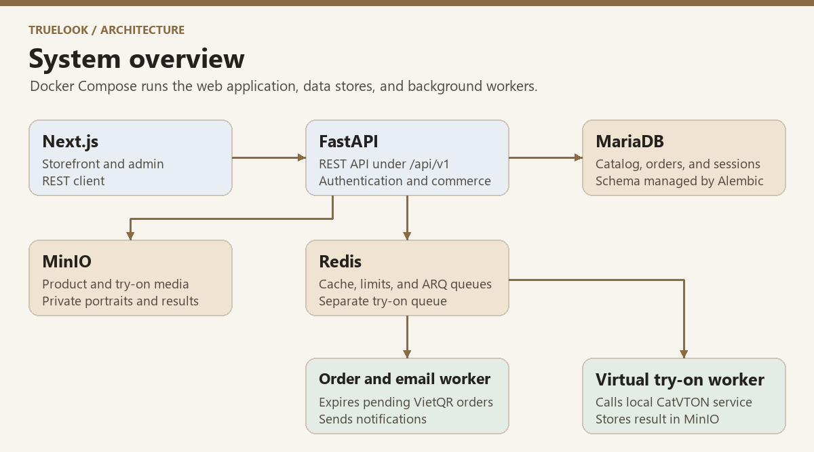
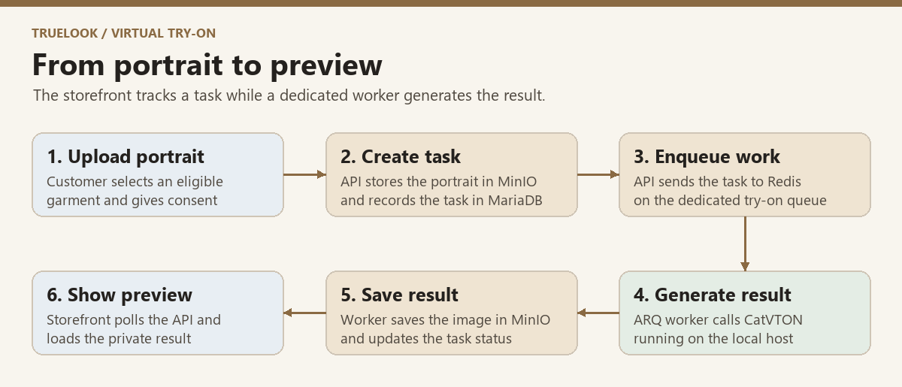

<h1 align="center">TrueLook</h1>

<p align="center">
  A fashion storefront with virtual try-on, checkout, and an admin dashboard.
</p>

<p align="center">
  <strong>Next.js</strong> · <strong>FastAPI</strong> · <strong>MariaDB</strong> · <strong>Docker Compose</strong>
</p>

<p align="center">
  <a href="#quickstart">Quickstart</a> ·
  <a href="#features">Features</a> ·
  <a href="#tech-stack">Tech Stack</a> ·
  <a href="#architecture">Architecture</a> ·
  <a href="#project-structure">Project Structure</a> ·
  <a href="#virtual-try-on">Virtual Try-On</a> ·
  <a href="#configuration">Configuration</a> ·
  <a href="#development">Development</a> ·
  <a href="#documentation">Documentation</a>
</p>

---

## Features

| Area | What you can do |
| --- | --- |
| **Storefront** | Search and filter the catalog, read reviews, choose a size and color, and save items to a browser-local wishlist. |
| **Virtual try-on** | Upload a portrait and preview an eligible garment. The default `mock` engine returns a stamped "DEMO PREVIEW" image without running AI; the optional `catvton` engine runs real CatVTON inference. |
| **Checkout** | Place a multi-item order with cash on delivery (COD) or VietQR, track its status, and cancel eligible orders. The API recalculates prices and checks stock for each variant. |
| **Administration** | Manage products and images, adjust variant inventory, review recent orders and low stock, and reconcile payments. |

VietQR generates VND payment codes and processes confirmations through the application webhook. Automatic bank notifications require a separate provider integration. The example receiving account `0000000000` is fake: do not transfer real money to demo QR codes. [Payment setup](docs/PAYMENT_SETUP.md) · [Demo payments](docs/DEMO_PAYMENTS.md)

## Tech Stack

| **Layer** | **Technology** |
| :--- | :--- |
| **Architecture** | Next.js web app, FastAPI organized by feature, and separate ARQ workers |
| **Runtime** | Python 3.12 and Node.js 22 in Docker |
| **Frontend** | Next.js 16 App Router, React 19, TypeScript, Tailwind CSS, and Radix UI |
| **Client Data** | Axios for API requests and SWR for caching and revalidation |
| **API** | FastAPI on Uvicorn with versioned REST routes under `/api/v1` |
| **Validation** | Pydantic schemas for API payloads and Zod schemas for forms |
| **Error Handling** | FastAPI exception handlers with JSON fields `code`, `message`, and `details` for application errors |
| **Database** | MariaDB 11.2, SQLAlchemy, and PyMySQL |
| **Migrations** | Alembic with a dedicated migration service in Docker Compose |
| **Caching and Rate Limits** | Redis 7 and SlowAPI |
| **Authentication** | PyJWT access tokens, HttpOnly refresh cookies, and persistent device sessions |
| **CORS** | FastAPI CORS middleware configured through `CORS_ORIGINS` |
| **Background Jobs** | ARQ queues for order expiration, email, and virtual try-on |
| **Media** | MinIO object storage and Pillow image validation |
| **Virtual Try-On** | Mock engine by default; optional CatVTON inference service called over HTTP by the Dockerized ARQ worker |
| **Payments** | Cash on delivery and VietQR with an application webhook and admin reconciliation |
| **Email** | Jinja2 templates with console output or SMTP via aiosmtplib |
| **API Docs** | OpenAPI and Swagger UI at `/docs` |
| **Containerization** | Multi-stage backend and frontend Dockerfiles with Docker Compose orchestration |
| **Testing and CI** | pytest, Hypothesis, Ruff, Vitest, Playwright, and GitHub Actions |

## Architecture

### System overview



The storefront and admin dashboard share the FastAPI backend under `/api/v1`. Redis backs separate queues so try-on processing can run independently of order expiration and email delivery.

### Virtual try-on pipeline



The ARQ worker runs in Docker. With the default `VTON_ENGINE=mock` it calls no inference service. With `VTON_ENGINE=catvton` it calls CatVTON over HTTP at `VTON_SERVICE_URL`: `http://catvton:8080` for the GPU Compose profile, or `http://host.docker.internal:8080` for a service running natively on the host.

## Project Structure

```text
.
├── backend/
│   ├── app/
│   │   ├── core/             # Settings, database, authentication, and shared errors
│   │   ├── features/         # Routes, schemas, models, and business logic
│   │   ├── integrations/     # MinIO, Redis, VietQR, SMTP, and CatVTON clients
│   │   ├── jobs/             # Order, email, and try-on tasks
│   │   ├── main.py           # FastAPI app and middleware
│   │   ├── worker.py         # Order and email worker
│   │   └── vton_worker.py    # Dedicated virtual try-on worker
│   ├── alembic/versions/     # Database migrations
│   └── tests/               # Backend unit and integration tests
├── frontend/
│   ├── app/                 # Storefront, account, and admin routes
│   ├── components/          # Shared UI and feature components
│   ├── hooks/               # Client data and UI hooks
│   ├── lib/                 # API client, sessions, types, and validation
│   ├── tests/               # Vitest tests
│   └── e2e/                 # Playwright scenarios
├── vton-service/            # Optional CatVTON inference service
├── docker/                  # Supporting container build files
├── docs/
│   └── assets/              # System and try-on diagrams
├── .github/
│   ├── workflows/           # GitHub Actions workflows
│   └── scripts/             # Integration, smoke test, and backup scripts
├── .env.example             # Sample local configuration
└── docker-compose.yml       # Local stack and optional GPU profile
```

[Backend guide](backend/README.md) · [Frontend guide](frontend/README.md) · [Documentation index](docs/README.md)

## Quickstart

### Prerequisites

Use Docker with Linux containers and Docker Compose v2 or later. The first build needs an internet connection to fetch base images and dependencies.

### Start the stack

From the repository root, create a local configuration if you do not already have one. The examples below use PowerShell.

```powershell
if (-not (Test-Path .env)) { Copy-Item .env.example .env }
```

In `.env`, replace the example passwords, set `SECRET_KEY` to at least 32 characters, and make sure the application credentials match the MinIO credentials. Then start the stack and create the first administrator.

```powershell
docker compose config --quiet
docker compose up --build -d --wait
docker compose exec api python -m app.cli create-admin --email admin@your-domain.test --username shopadmin
```

Compose applies database migrations before starting the API and workers. The admin command prompts for a password. With a fresh database, sign in to the admin dashboard, create a category, and add a product with an image and an in-stock variant. Register a customer account in the storefront to try checkout.

### Local URLs

| Service | Default address |
| --- | --- |
| Storefront | [localhost:3000/store](http://localhost:3000/store) |
| Admin sign-in | [localhost:3000/login](http://localhost:3000/login) |
| Admin dashboard | [localhost:3000/dashboard](http://localhost:3000/dashboard) |
| Swagger UI | [localhost:8000/docs](http://localhost:8000/docs) |
| API health | [localhost:8000/api/v1/health](http://localhost:8000/api/v1/health) |
| MinIO console | [localhost:9001](http://localhost:9001) |

## Virtual Try-On

Try-on works out of the box with the default `VTON_ENGINE=mock`, which `.env.example`, development, and CI use. The mock engine never runs AI and stamps "DEMO PREVIEW" on every result.

To run real CatVTON natively on the host CPU (slow), start the host service first, then set these values in the repository root `.env`.

```dotenv
VTON_ENGINE=catvton
VTON_SERVICE_URL=http://host.docker.internal:8080
```

Recreate the API and the try-on worker so they pick up the change.

```powershell
docker compose up -d api vton_worker
```

`host.docker.internal` resolves on Docker Desktop. On Linux Docker Engine, add `extra_hosts: ["host.docker.internal:host-gateway"]` to the `vton_worker` service or use an address of the host that containers can reach, and make the host service listen on `0.0.0.0`. To set up CatVTON on the host or use the optional NVIDIA GPU profile, follow the [virtual try-on guide](docs/VTON.md).

1. In the admin dashboard, add a **Try-on garment** image to a product in a supported category. Tag the matching color if the product has multiple colors.
2. Sign in as a customer, open the product page, and select **Virtual try-on**. Upload a portrait and give consent to process it.
3. Wait for the dedicated worker to process the request. The result appears in the storefront when it is ready.

Portraits and results are private to the customer who submitted the task and expire after 24 hours by default. For supported categories, image requirements, and engine setup, see the [virtual try-on guide](docs/VTON.md).

## Configuration

Environment variables override `.env`. The frontend has its own `.env.local` for native development. Do not commit real secrets or local `.env` files. Variables that are not in `.env.example` fall back to the defaults in `docker-compose.yml` and `backend/app/core/config.py`.

| Settings | Purpose |
| --- | --- |
| `MARIADB_ROOT_PASSWORD`, `MARIADB_DATABASE`, `MARIADB_USER`, `MARIADB_PASSWORD` | Database setup; application connections use the app user |
| `REDIS_PASSWORD` | Redis authentication |
| `SECRET_KEY` | JWT signing key; minimum 32 characters |
| `MINIO_ROOT_USER`, `MINIO_ROOT_PASSWORD`, `MINIO_ACCESS_KEY`, `MINIO_SECRET_KEY`, `MINIO_BUCKET` | Object-storage credentials and bucket |
| `MINIO_EXTERNAL_URL`, `NEXT_PUBLIC_IMAGE_HOST` | Browser-accessible image origin |
| `NEXT_PUBLIC_API_BASE_URL` | API origin or base ending in `/api/v1` |
| `CORS_ORIGINS` | Comma-separated allowed frontend origins |
| `REFRESH_COOKIE_SECURE`, `REFRESH_COOKIE_SAMESITE` | Refresh-cookie policy; use secure=false only for local plain HTTP |
| `FORWARDED_ALLOW_IPS` | Trusted reverse-proxy addresses |
| `VIETQR_BANK_ID`, `VIETQR_BANK_NAME`, `VIETQR_ACCOUNT_NO`, `VIETQR_ACCOUNT_NAME` | QR receiving-bank configuration |
| `VIETQR_WEBHOOK_SECRET` | Expected `X-Webhook-Secret`; an empty secret does not authorize callbacks |
| `ORDER_EXPIRE_MINUTES` | Pending VietQR lifetime; default 30 minutes, shared by API and worker |
| `VTON_ENABLED`, `VTON_ENGINE`, `VTON_SERVICE_URL`, `VTON_DAILY_QUOTA`, `VTON_RETENTION_HOURS` | Virtual try-on: engine (`mock` or `catvton`), inference service URL, per-user daily quota, result retention |
| `APP_ENV` | Environment name |
| `EMAILS_ENABLED`, `EMAILS_CONSOLE_LOG` | Email disabled, console-only, or SMTP mode |
| `SMTP_HOST`, `SMTP_PORT`, `SMTP_USER`, `SMTP_PASSWORD`, `EMAILS_FROM_EMAIL`, `EMAILS_FROM_NAME` | SMTP sender configuration |
| `MARIADB_PORT`, `REDIS_PORT`, `MINIO_PORT`, `MINIO_CONSOLE_PORT`, `API_PORT`, `FRONTEND_PORT` | Host-port overrides |

Compose derives `DATABASE_URL` and `REDIS_URL` from its credentials unless they are set explicitly. After changing host ports, update the matching public URLs and `CORS_ORIGINS`. To send real email, set `EMAILS_ENABLED=true`, `EMAILS_CONSOLE_LOG=false`, and valid SMTP credentials; console mode logs a rendered notification and does not deliver it.

## Development

Use Node.js 22 and pnpm 10.33.4 for frontend development. The backend lockfiles target Python 3.13 on Windows and Python 3.12 on Linux. The component guides cover hot reload, dependency installation, and test setup. [Frontend guide](frontend/README.md) · [Backend guide](backend/README.md)

### Tests

| Check | Run from | Command |
| --- | --- | --- |
| Backend unit and regression tests | `backend/` | `.venv/Scripts/python.exe -m pytest tests --ignore=tests/integration -q` |
| Backend lint and format | `backend/` | `.venv/Scripts/python.exe -m ruff check app tests` and `.venv/Scripts/python.exe -m ruff format --check app tests` |
| Frontend unit tests and type check | `frontend/` | `pnpm test` and `pnpm exec tsc --noEmit` |
| Frontend lint and build | `frontend/` | `pnpm exec eslint . --max-warnings=0` and `pnpm build` |
| MariaDB integration tests | Repository root | `backend/.venv/Scripts/python.exe .github/scripts/run_integration.py` |
| Full-stack smoke test | Repository root | `backend/.venv/Scripts/python.exe .github/scripts/compose_smoke.py` |

The commands use Python from the backend virtual environment, not the system Python; on Linux the interpreter is `.venv/bin/python`. Set `REDIS_URL=memory://` and `EMAILS_ENABLED=false` in the backend unit test shell. Keep `test.db` dedicated to tests. The integration and smoke scripts create and remove their own disposable Docker resources; do not point `TEST_DATABASE_URL` at the main database or any data you need to keep. To include browser scenarios in the smoke test, run `pnpm install --frozen-lockfile` and then `pnpm exec playwright install chromium` from `frontend/`, and set `SMOKE_BROWSER_TESTS=1` before running the script.

## Documentation

| Topic | Reference |
| --- | --- |
| Compose project, host ports, and local services | [Local environment](docs/LOCAL_ENVIRONMENT.md) |
| Environment variables | [Configuration](#configuration) · [Environment example](.env.example) |
| COD, VietQR, and payment reconciliation | [Demo payments](docs/DEMO_PAYMENTS.md) · [Payment setup](docs/PAYMENT_SETUP.md) |
| CatVTON, garment images, and retention | [Virtual try-on](docs/VTON.md) |
| Schema changes and data recovery | [Migration notes](docs/MIGRATION_NOTES.md) · [Backup and restore](docs/DEMO_BACKUP.md) |
| Storefront and admin design | [Design references](docs/design-review/README.md) |

Use the same hostname across frontend and API configuration so that CORS and cookies work as expected. Rebuild the frontend after changing `NEXT_PUBLIC_*` variables. These commands show stack status, recent logs, and the current database revision.

```powershell
docker compose ps
docker compose logs --tail 100 migrate api arq_worker vton_worker frontend
docker compose exec api alembic current
```

- The health endpoint reports database and Redis status only. `storage=configured` is not a live MinIO check, so verify MinIO and the workers separately.
- The main Compose project is `truelook`. For an extra isolated stack, use another project name and different host ports. Do not start the retired `fastapi-founder` or `truelook-demo` stacks on this machine.
- `docker compose down` preserves volumes. Adding `--volumes` deletes the project's database and image data. SQL dumps do not include MinIO objects, so back up MariaDB and MinIO separately.

## Current Limits

Contact does not submit messages, the wishlist is browser-only, and the blog, careers, and press pages are informational. Dynamic shipping rates, carrier integrations, coupons, automatic refunds, and SePay/Casso bank adapters are not implemented. Real CatVTON output is not verified in CI, and load, GPU inference, and real SMTP delivery have not been benchmarked. Green unit tests alone are not production certification.

## License

TrueLook is proprietary. This repository does not grant a public license.
